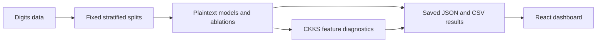

# CipherBench

CipherBench is a small research project on convolutional inference with approximate homomorphic encryption. It reconstructs a shallow CNN from a published paper, measures plaintext and CKKS behavior on binary tasks from scikit-learn's digits dataset, and presents the saved results in a static dashboard.

The project is an independent implementation and diagnostic study. It does not claim to reproduce the paper's undisclosed training procedure or to provide end-to-end encrypted classification.

## What the project runs



The Python code loads digits 0 and 1 for the primary task and digits 3 and 8 for a secondary task. It evaluates Logistic Regression, a shallow CNN, and a float64 implementation of the CNN's polynomial computation graph. The CNN uses a valid 3×3 convolution, square activation, 2×2 average pooling, and a linear classification head. Controlled variants compare per-feature standardization with fixed pixel scaling and a training-only activation-range penalty.

The CKKS paths use TenSEAL to evaluate selected CNN feature-extraction operations. They decrypt intermediate features before the classification head, so they are partial encrypted-inference experiments. The static GitHub Pages site presents saved results. The local dashboard can launch the Python Phase 3 pipeline and load its newly measured results.

## Main results

All scores below come from saved held-out predictions. Each task has one fixed 70/30 stratified split with 108 test samples; the secondary task uses a separate split. These results describe those splits and should not be read as estimates across datasets or repeated test samples.

| Task | Model or variant | Accuracy | Notes |
|---|---|---:|---|
| Digits 0 vs 1 | Logistic Regression | 100.00% | Baseline; 108 test samples |
| Digits 0 vs 1 | TinyCNN and float64 graph | 99.07% | Same one-error prediction set |
| Digits 0 vs 1 | A0–A3 ablations | 99.07% | Same accuracy on this split |
| Digits 3 vs 8 | A0, standardized control | 95.37% | 6 errors |
| Digits 3 vs 8 | A1, pixel scaling | 99.07% | 1 error |
| Digits 3 vs 8 | A3, pixel scaling plus range penalty | 99.07% | Same predictions as A1 |

For the primary task, the tested CKKS feature path matched the float64 graph's class decisions on all 108 test samples. This is a numerical agreement check, not a claim of 100% classification accuracy or a fully encrypted model. The CNN's plaintext head receives decrypted pooled features. A second partial path decrypts earlier, after the squared convolution map.

The fixed pixel scaling improved the secondary task on this split, but adding the range penalty did not change predictions relative to pixel scaling alone. The small number of test samples, single split per task, and partial encryption boundary limit what can be concluded.

## Run locally

### Dashboard

Requires Node.js 22 or newer and npm.

```sh
npm ci
npm run dev
```

Open the local address printed by Vite and select **Experiments & Reproducibility**. The **Start training + test** action runs Phase 3 model selection, CKKS validation diagnostics, and the frozen held-out evaluation. It requires the Python environment described below. Run outputs are isolated in the operating system's temporary directory; **Clear temporary run data** deletes that run and restores the checked-in results. The local run API is available only in Vite development mode.

GitHub Pages is static hosting and cannot start Python jobs. Its dashboard links users to the local setup; use the deployed site to inspect saved results, and use `npm run dev` when you need to run a fresh training and test cycle.

To create and preview the static site:

```sh
npm run build
npm run preview
```

### Python experiments

Requires Python 3.12. The pinned environment was tested on Windows with TenSEAL 0.3.18. On Windows PowerShell:

```powershell
py -3.12 -m venv .venv
.\.venv\Scripts\python.exe -m pip install -r requirements.txt
.\.venv\Scripts\python.exe -m unittest discover -v
```

On macOS or Linux, use `.venv/bin/python`; TenSEAL wheel availability can vary by platform.

The main entry points are:

| Command | Purpose |
|---|---|
| `python scripts/evaluate_baselines.py` | Rebuild the primary data split and evaluate baseline models |
| `python scripts/phase0_smoke.py` | Check TenSEAL installation, CKKS operations, and paper parameters |
| `python scripts/ckks_diagnostic.py` | Run the saved-model CKKS feature diagnostic |
| `python scripts/run_phase3_ablation.py` | Run the controlled two-task ablations |
| `python scripts/evaluate_phase3_ckks.py` | Evaluate CKKS partial paths on the saved validation split |

Most experiment scripts write into `artifacts/` by default. The Phase 3 runner also accepts `CIPHERBENCH_ARTIFACT_DIR` to direct outputs elsewhere; the local dashboard uses a temporary directory automatically so its runs do not replace the checked-in results.

## Reproducing and interpreting results

`artifacts/` contains split indices, model configurations, test labels and predictions, metrics, CKKS numerical errors, timings, and ciphertext-size measurements. `scripts/` contains the experiment entry points; `data/`, `models/`, `metrics/`, and `he/` contain the implementation. `src/` is the dashboard.

The CNN is a reconstruction, not an exact reproduction: the paper does not specify all training, split, or model details. The local measurements use fixed seeds and saved splits, and preprocessing parameters are fit on training data. For CKKS, the literal paper parameter chain was tested and its multiplication error recorded; the local diagnostic chain is separately identified in its saved configuration. Timing and serialized intermediate sizes depend on these local paths and are not directly comparable to the paper's measurements.

The paper describes a 49% result for its encrypted CNN workflow, where pooled features are decrypted before a Logistic Regression head. CipherBench's results use different local parameters and are not a like-for-like reproduction or comparison. No statistical significance or general performance claim is made from these single splits.

## GitHub Pages

The workflow in `.github/workflows/pages.yml` tests and builds the dashboard on pushes to `main`, then deploys it to GitHub Pages. In the repository's **Settings → Pages**, select **GitHub Actions** as the source. The deployed URL is shown in the workflow run's deployment environment.

## Reference

- C.-A. Deonise et al., “Homomorphic Encryption for Privacy-Preserving Machine Learning Inference,” *Annals of the Academy of Romanian Scientists*, 18(2), 50–61 (2025). [DOI: 10.56082/annalsarsciinfo.2025.2.50](https://doi.org/10.56082/annalsarsciinfo.2025.2.50)
- Scikit-learn, [`load_digits`](https://scikit-learn.org/stable/modules/generated/sklearn.datasets.load_digits.html).
- A. Benaissa et al., “TenSEAL: A Library for Encrypted Tensor Operations Using Homomorphic Encryption.” [arXiv:2104.03152](https://arxiv.org/abs/2104.03152).

The research PDFs are not included in this repository.

## License

No license has been selected. Reuse and redistribution are not yet licensed.
