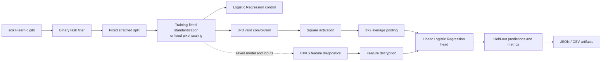
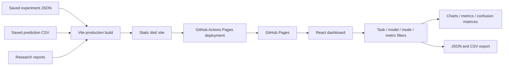

# CipherBench

**A reproducible research workspace for small CNN inference under CKKS.**

CipherBench compares plaintext digit-classification baselines with polynomial CNN experiments and diagnostic CKKS feature extraction. The repository contains the model and encryption code, fixed data splits, saved predictions, evaluation artifacts, research reports, tests, and a static dashboard for exploring the results.

The dashboard reads saved files. It does not run training or encryption jobs in a browser, and it does not require a remote API or database.

## What is in the repository

- **Research code:** dataset loading and split management, baseline models, the TinyCNN reconstruction, its plaintext-equivalent polynomial graph, CKKS diagnostic paths, evaluation scripts, and tests.
- **Saved evidence:** model configurations, split indices, labels, predictions, metrics, numeric errors, timings, and serialized intermediate-size measurements in [`artifacts/`](artifacts/).
- **Interactive dashboard:** compare published references and local results, inspect confusion matrices and class metrics, explore execution boundaries, and export filtered results as JSON or CSV.
- **Research notes:** methods, architecture, baseline and ablation results, CKKS diagnostics, and a scoped novelty review.

## Research architecture

### Model and evaluation path



The supported encrypted paths cover parts of feature extraction. The `mask_dot` path decrypts pooled features before the linear head. The `im2col_partial` path decrypts the squared convolution map even earlier. Neither path runs the full classifier in ciphertext. The training-only range penalty is an objective used during model fitting; it is not an inference layer.

### Dashboard and GitHub Pages



At build time Vite copies the selected artifacts and reports into `dist/`. The published dashboard is static: it fetches those files from the repository’s Pages path, with no backend service.

## Findings at a glance

- **Digits 0 vs 1:** Logistic Regression scored 100% on the saved 108-sample test split. All four controlled CNN variants A0–A3 scored 99.07%.
- **Digits 3 vs 8:** A0/A2 scored 95.37%; A1/A3 scored 99.07% on the separate saved 108-sample split.
- **A1 and A3 tied:** they made identical predictions on both tasks. The range penalty did not show an additional accuracy benefit beyond pixel scaling.
- **CKKS fidelity:** the recorded feature path matched the plaintext-equivalent graph’s decisions on 108/108 test samples for the primary task. This is a numerical agreement result, not fully encrypted end-to-end classification.
- **Interpretation:** these are descriptive results from one held-out split per task. The primary test split was reused across the baseline, CKKS, and ablation work; the additional seeds are fixed-row validation runs. No statistical significance, general superiority, or architectural novelty is claimed.

See [`FINAL_RESULTS.md`](FINAL_RESULTS.md) for metrics, confusion matrices, comparisons with the paper, numerical errors, latency scope, and limitations.

## Run the dashboard locally

Requirements: Node.js 22 or newer and npm.

```powershell
npm ci
npm run dev
```

Open the local URL printed by Vite (normally `http://127.0.0.1:5173/`). The development server includes a small allow-listed middleware for reading local artifacts and reports. There is no separate backend command.

Run dashboard tests and create a production build:

```powershell
npm test
npm run build
npm run preview
```

The preview command serves the generated static site locally. `dist/` is generated output and is not committed.

## Re-run the Python experiments

The saved results are included so the dashboard works without running the experiments. To recreate the tested Python environment on Windows with Python 3.12 installed:

```powershell
py -3.12 -m venv .venv
.\.venv\Scripts\python.exe -m pip install -r requirements-phase0.txt -r requirements-phase1.txt
```

Run the unit tests with:

```powershell
.\.venv\Scripts\python.exe -m unittest discover -v
```

Main research entry points:

| Script | Purpose |
|---|---|
| `scripts/phase0_smoke.py` | Minimal TenSEAL CKKS feasibility checks and parameter diagnostics. |
| `scripts/evaluate_baselines.py` | Rebuild the dataset split and evaluate baseline models. |
| `scripts/ckks_diagnostic.py` | Compare saved polynomial-model computations with CKKS feature extraction. |
| `scripts/run_phase3_ablation.py` | Run the controlled A0–A3 comparisons on the two digit tasks. |
| `scripts/evaluate_phase3_ckks.py` | Re-evaluate CKKS partial paths using frozen model artifacts. |

Experiment scripts write to saved artifact paths. Preserve a copy of `artifacts/` before rerunning them if you need to retain the checked-in results. Detailed commands and assumptions are in [`RESEARCH_METHODOLOGY.md`](RESEARCH_METHODOLOGY.md), [`ENVIRONMENT_REPORT.md`](ENVIRONMENT_REPORT.md), and the individual reports.

## GitHub Pages deployment

The workflow at [`.github/workflows/pages.yml`](.github/workflows/pages.yml) runs the dashboard tests, builds the static site with the correct repository subpath, and deploys `dist/` when changes reach `main`.

1. Create a GitHub repository for this project.
2. In **Settings → Pages**, set the publishing source to **GitHub Actions**.
3. Push the `main` branch. The workflow tests, builds, and deploys the site; its URL appears in the successful deployment environment.

GitHub Pages sites are publicly accessible. The supplied research PDFs and generated presentation outputs are intentionally excluded from the repository; the reports cite the sources instead. See [GitHub’s Pages publishing documentation](https://docs.github.com/en/pages/getting-started-with-github-pages/configuring-a-publishing-source-for-your-github-pages-site) for repository and visibility requirements.

## Project map

```text
data/       Dataset loading, binary task mappings, splits, diagnostics
models/     Baselines, TinyCNN reconstruction, polynomial graph
he/         TenSEAL CKKS feature-extraction implementation
metrics/    Classification metrics and statistical summaries
scripts/    Feasibility, baseline, CKKS, and ablation runners
artifacts/  Saved metrics, predictions, model parameters, splits, diagnostics
src/        React dashboard, artifact adapters, charts, and UI components
tests/      Python and frontend tests
*.md        Research reports and reproducibility documentation
```

## Research documentation

- [Research methodology](RESEARCH_METHODOLOGY.md)
- [System architecture](SYSTEM_ARCHITECTURE.md)
- [Final results](FINAL_RESULTS.md)
- [Baseline reconstruction](BASELINE_REPORT.md)
- [CKKS numerical diagnostics](CKKS_DIAGNOSTIC_REPORT.md)
- [Controlled ablations](ABLATION_REPORT.md)
- [Novelty review](NOVELTY_REVIEW.md)
- [Environment and feasibility](ENVIRONMENT_REPORT.md)

## Scope and source references

The main reference is Deonise et al., “Homomorphic Encryption for Privacy-Preserving Machine Learning Inference,” *Annals of the Academy of Romanian Scientists*, 18(2), 50–61 (2025), [DOI: 10.56082/annalsarsciinfo.2025.2.50](https://doi.org/10.56082/annalsarsciinfo.2025.2.50). The related-work and methods reports cite additional work on CKKS arithmetic, polynomial networks, encrypted CNNs, and activation-range control.

The TinyCNN is a documented reconstruction because the paper leaves some training and evaluation details unspecified. Its reported 0.49 CKKS accuracy and CipherBench’s measurements are not directly comparable: the local encrypted feature paths use a plaintext head and have different decryption boundaries. The novelty review describes the design as a narrow, reproducible diagnostic study and does not claim that its architecture is unprecedented.

No software license has been selected. Until one is added, the repository is available to view, but reuse and redistribution are not licensed.
