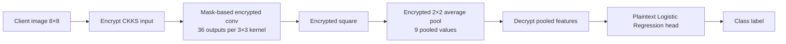
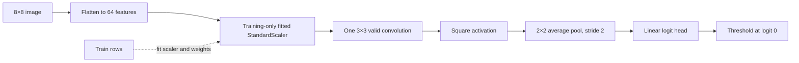
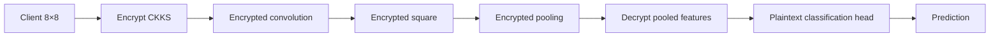
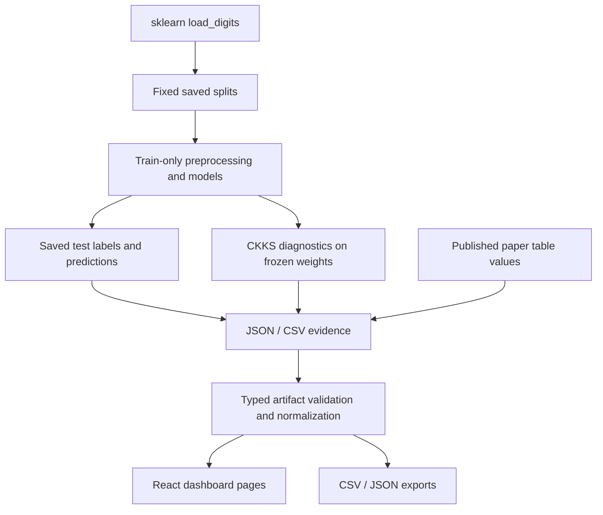

# System Architecture

CipherBench contains a Python experiment pipeline, frozen local evidence artifacts, and a React/TypeScript dashboard. There is no independent API backend: Vite serves the static frontend and whitelisted local JSON/CSV/report files during development; production bundles the selected artifacts.

## 1. Original paper TinyCNN workflow

The paper describes a 3×3 valid convolution, square activation, and 2×2 average pooling. Its detailed method decrypts pooled features before a Logistic Regression head. The paper's broad framing of end-to-end protection and its detailed CNN boundary are not fully aligned; this diagram follows the detailed CNN workflow.



## 2. CipherBench plaintext reconstruction



The `TinyCNN` and float64 polynomial graph use the same weights and arithmetic. The latter is a plaintext-equivalent reference for CKKS, not encrypted evaluation.

## 3. Proposed RC-TinyCNN candidate

```mermaid
flowchart LR
  X[Raw 8×8 pixels 0…16] --> S[Fixed scale x / 16]
  S --> C[3×3 valid conv<br/>one kernel → 6×6]
  C --> A[Square activation]
  A --> P[2×2 avg pool<br/>3×3]
  P --> H[Linear logit head]
  H --> O[Threshold at 0]
  C -. training only .-> R[Range loss λ mean(max(|z|−B,0)²)]
  R -. gradient during fit only .-> C
```

The range term affects training gradients only. It is absent from inference. A1 is pixel scaling without range loss; A3 adds this training objective. A1 and A3 tied on both saved test tasks, so range regularization has not shown an added accuracy benefit.

## 4. CKKS encrypted feature extraction and plaintext boundary



Phase 2/`mask_dot` decrypts after pooling. The Phase 3 `im2col_partial` route decrypts after encrypted square, before pooling and head. Neither path keeps the entire classification pipeline encrypted. CKKS approximate arithmetic consumes modulus levels during multiplication/rescaling and accumulates numeric error; exact parameter and state details live in the saved CKKS artifacts.

## 5. Experiment and dashboard data flow



The published reference remains separate from locally measured results. The dashboard does not invoke the experiment runner; the existing runner writes to frozen artifacts and takes several minutes.

## Components and reproducibility

- `data/`: load and split the sklearn digits tasks, class mapping, diagnostics.
- `models/`: Logistic Regression, majority control, TinyCNN training, polynomial graph, range penalty.
- `metrics/`: held-out measures and statistics.
- `he/` and `scripts/`: TenSEAL CKKS paths and reproducible evaluation entry points.
- `artifacts/`: saved model parameters, split indices, labels/predictions, metrics, numeric errors, timings, and serialized-size records.
- `src/data/`: typed validation, normalization, comparisons, and architecture records for the UI.
- `src/ui/`: responsive three-page React application.

### References

Deonise et al. (2025), DOI [10.56082/annalsarsciinfo.2025.2.50](https://doi.org/10.56082/annalsarsciinfo.2025.2.50); Mali (2025), [IACR ePrint 2025/972](https://eprint.iacr.org/2025/972); TenSEAL, Benaissa et al. (2021), [arXiv:2104.03152](https://arxiv.org/abs/2104.03152).
